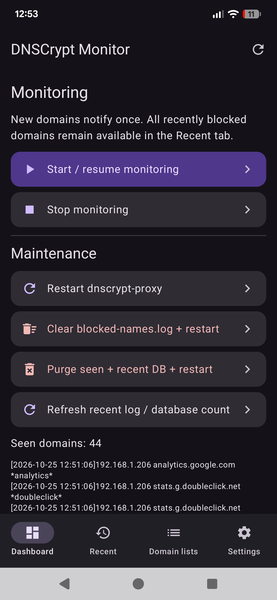
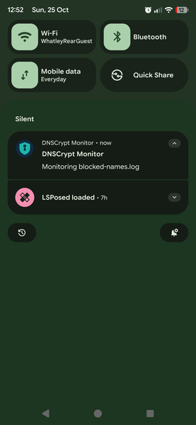
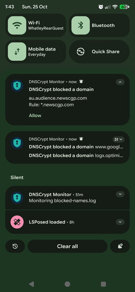
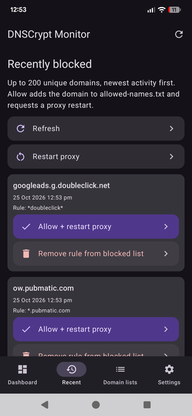
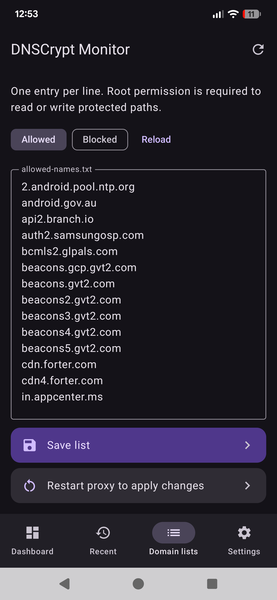
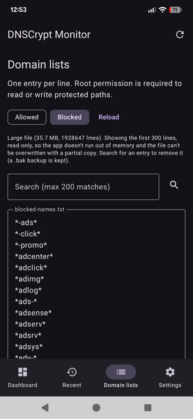
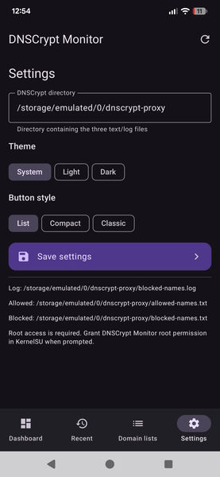

# DNSCrypt Monitor for Android

This is a Dnscrypt Proxy Manager for Android that recreates the functions i use in my Windows (python) version

It is a personal build that satisfies my needs, and may be useful for others

## Functions:

Dsncrypt data files path: using /storage/emulated/0/dnscrypt-proxy  (sdcard/dnscrypt-proxy) as the path for log and associated block and allow lists
Note: the path is changeable in Settings

### Main function:

- Monitors the blocked-names.log file and 
 - parses and displays the blocked domain as a notification with Allow action (and also populates the domains in the Recents tab of app in case you dismiss or miss the notification)
  - Foreground service tails the log from its current end, so old entries are not notified on startup.
  - Parsed domains are stored in app-private SQLite: a seen table prevents duplicate notifications, and a separate recent-blocked history survives log clearing.
  - Blocked-domain notifications are not automatically removed; Android controls how long the heads-up popup appears, while the notification remains in the notification shade until dismissed. The Recent tab is a second chance to allow domains.
  - Android 13+ notification permission is requested at first launch. Disable battery optimization if Android repeatedly stops monitoring.
 - allow action writes the domain to allowed-names.txt and restarts dnscrypt-proxy cleanly
     
 
### App Tabs:

Dashboard

- Start/Resume monitoring (Monitoring begins after boot)
- Stop Monitoring
- Restart dnscrypt-proxy
- Clear blocked-names.log & Restart
- Purge seen & recent db & restart
- Refresh recent log/database count - show at bottom of screen after pressing

Recent

- Shows up to 200 (uniqued) domain names, latest first
- Each domain shown has the option to Allow & Restart dnscrypt-proxy, as well as (as backup/optionally) Remove the domain from blocked-names.txt
- Refresh the list of blocked domains
- Restart dnscrypt-proxy

Domain Lists

- Allowed Domains, shown by default - this is editable by hand, and a Save List button and Restart proxy button are there to update allowed-names.txt after edit
- Blocked Domains, shows the first 300 lines of blocked-names.txt (theres a hard filesize limit on text controls, and my personal blocked-names.txt file is 35Mb). Beyond 300 lines, you can search for, and remove domains
- Reload, reloads allowed and Blocked lists

Settings

- Dnscrypt Directory - must point to where your dnscrypt-proxy blocked and allow files are - by default (and using my own dnscrypt-proxy magisk module)) this is /storage/emulated/0/dnscrypt-proxy  (sdcard/dnscrypt-proxy) 
- Theme - change themes
- Button Style - change button style
- Save Settings - saves the settings

### Requirements: 

- A running dnscrypt-proxy service and setup
- blocked-names.txt and allowed-names.txt lists and blocked-names.log configured in the Dnscrypt Directory in app Settings
- `blocked-names.log`
- `allowed-names.txt`
- `blocked-names.txt`
- Root granted to Dnscrypt Monitor in your root manager app

### Complimentary Magisk Module:

A complete working magisk module, using my own basic setup (with basic blocked-names.txt and blank allowed-names.txt files) will be available here (link to be added) to get you started
The Dnscrypt Manager app will not be bundled with it to keep it a separate and manageable project
